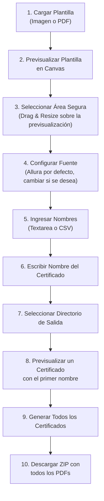
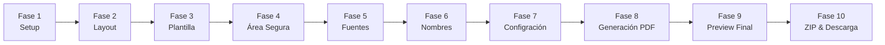

# 📜 Plan: Generador de Certificados — ComSoc Certificate Generator

## 📋 Resumen del Proyecto

Aplicación web local que permite generar certificados PDF en masa a partir de una plantilla (imagen o PDF), colocando nombres en un **área segura** seleccionada visualmente por el usuario. Los certificados se exportan como **PDF A4 Horizontal (landscape)**.

---

## 🖼️ Referencia Visual

La plantilla base es un certificado como el del **Encuentro Andino de Ciberseguridad — IEEE ComSoc**, donde el nombre del participante (ej. *Cristhian Alejandro Moreno Delgado*) se escribe en fuente cursiva (Allura) sobre un área específica del diseño, justo debajo de "Otorgado a".

---

## 🛠️ Stack Tecnológico

| Componente | Tecnología | Justificación |
|---|---|---|
| **Frontend** | React 18 + TypeScript | Interfaz interactiva con previsualización en tiempo real |
| **Bundler** | Vite | Desarrollo rápido, HMR instantáneo |
| **Estilos** | Tailwind CSS 3 | Diseño rápido y responsivo |
| **Gestión de estado** | React Context + `useReducer` | Suficiente para la complejidad del proyecto |
| **Canvas/Selección de área** | `react-konva` (Konva.js) | Manipulación de canvas con drag & drop para seleccionar el área segura |
| **Fuentes** | Google Fonts API (Allura por defecto) | Carga dinámica de fuentes desde Google Fonts |
| **Generación de PDF** | `pdf-lib` | Manipulación de PDFs en el navegador, sin backend |
| **Lectura de PDF (plantilla)** | `pdfjs-dist` (PDF.js de Mozilla) | Renderizar PDFs como imagen para previsualización |
| **Lectura de CSV** | `papaparse` | Parseo robusto de archivos CSV |
| **Descarga de archivos** | `jszip` + `file-saver` | Empaquetar múltiples PDFs en un ZIP para descarga |
| **Notificaciones** | `react-hot-toast` | Feedback visual al usuario |
| **Iconos** | `lucide-react` | Iconos modernos y ligeros |

---

## 📦 Requisitos Previos

- **Node.js** ≥ 18.x
- **npm** o **pnpm** (se usará pnpm)
- Navegador moderno (Chrome, Edge, Firefox)
- Conexión a internet (solo para cargar fuentes de Google Fonts en la previsualización)

---

## 🏗️ Arquitectura del Proyecto

```
Certificate Generator/
├── public/
│   └── fonts/                    # Fuente Allura descargada como fallback offline
│       └── Allura-Regular.ttf
├── src/
│   ├── assets/                   # Recursos estáticos
│   ├── components/               # Componentes React
│   │   ├── layout/
│   │   │   ├── Header.tsx
│   │   │   ├── Footer.tsx
│   │   │   └── MainLayout.tsx
│   │   ├── template/
│   │   │   ├── TemplateUploader.tsx       # Carga de plantilla (imagen/PDF)
│   │   │   ├── TemplatePreview.tsx        # Previsualización con canvas
│   │   │   └── SafeAreaSelector.tsx       # Selección de área segura (drag & resize)
│   │   ├── fonts/
│   │   │   ├── FontSelector.tsx           # Selector de fuente (dropdown con preview)
│   │   │   └── FontPreview.tsx            # Vista previa del texto con la fuente
│   │   ├── names/
│   │   │   ├── NameInput.tsx              # Campo de texto para nombres
│   │   │   ├── CsvUploader.tsx            # Carga de CSV
│   │   │   └── NameList.tsx               # Lista de nombres cargados
│   │   ├── config/
│   │   │   ├── CertificateNameInput.tsx   # Nombre del certificado
│   │   │   └── OutputConfig.tsx           # Directorio de salida
│   │   ├── preview/
│   │   │   └── CertificatePreview.tsx     # Previsualización final del certificado
│   │   └── generation/
│   │       ├── GenerateButton.tsx         # Botón para generar
│   │       └── ProgressBar.tsx            # Barra de progreso
│   ├── hooks/
│   │   ├── useTemplate.ts
│   │   ├── useFonts.ts
│   │   ├── useNames.ts
│   │   └── useCertificateGenerator.ts
│   ├── services/
│   │   ├── pdfGenerator.ts               # Lógica de generación de PDF con pdf-lib
│   │   ├── templateRenderer.ts           # Renderizar plantilla PDF a imagen
│   │   ├── fontLoader.ts                 # Carga dinámica de fuentes
│   │   └── csvParser.ts                  # Parseo de CSV con PapaParse
│   ├── types/
│   │   └── index.ts                      # Tipos TypeScript
│   ├── context/
│   │   └── CertificateContext.tsx         # Estado global
│   ├── utils/
│   │   ├── fileUtils.ts                  # Utilidades de archivos
│   │   └── nameFormatter.ts              # Formateo de nombres para archivos
│   ├── App.tsx
│   ├── main.tsx
│   └── index.css
├── PLAN.md
├── package.json
├── tsconfig.json
├── vite.config.ts
├── tailwind.config.js
├── postcss.config.js
└── README.md
```

---

## 🔄 Flujo de Trabajo del Usuario



---

## 📝 Paso a Paso de Implementación

### Fase 1: Configuración Inicial del Proyecto

**Paso 1.1 — Crear proyecto Vite + React + TypeScript**
```bash
pnpm create vite certificate-generator --template react-ts
cd certificate-generator
```

**Paso 1.2 — Instalar dependencias**
```bash
# Dependencias principales
pnpm add react-konva konva pdf-lib pdfjs-dist papaparse jszip file-saver react-hot-toast lucide-react

# Tipos TypeScript
pnpm add -D @types/papaparse @types/file-saver

# Tailwind CSS
pnpm add -D tailwindcss @tailwindcss/vite
```

**Paso 1.3 — Configurar Tailwind CSS**
- Configurar `tailwind.config.js`
- Agregar directivas de Tailwind en `index.css`

**Paso 1.4 — Configurar Vite**
- Configurar alias de rutas en `vite.config.ts`
- Configurar worker para `pdfjs-dist`

**Paso 1.5 — Descargar fuente Allura**
- Descargar `Allura-Regular.ttf` desde Google Fonts
- Colocar en `public/fonts/` para uso offline y embebido en PDFs
- Configurar `@font-face` en CSS para previsualización

---

### Fase 2: Estructura Base y Layout

**Paso 2.1 — Crear el Context global (`CertificateContext.tsx`)**
- Estado: plantilla cargada, área segura, fuente seleccionada, lista de nombres, nombre del certificado, directorio de salida
- Actions/Reducers para cada actualización

**Paso 2.2 — Crear tipos TypeScript (`types/index.ts`)**
```typescript
interface SafeArea {
  x: number;       // Posición X relativa (%)
  y: number;       // Posición Y relativa (%)
  width: number;   // Ancho relativo (%)
  height: number;  // Alto relativo (%)
}

interface TemplateData {
  file: File;
  type: 'image' | 'pdf';
  imageUrl: string;        // URL de previsualización
  originalWidth: number;
  originalHeight: number;
}

interface FontConfig {
  family: string;       // ej: "Allura"
  url: string;          // URL de Google Fonts o local
  size: number;         // Tamaño en pt
  color: string;        // Color del texto (hex)
}

interface CertificateConfig {
  template: TemplateData | null;
  safeArea: SafeArea | null;
  font: FontConfig;
  names: string[];
  certificateName: string;
  outputDir: string;
}
```

**Paso 2.3 — Crear layout principal**
- `Header.tsx`: Logo y título "ComSoc Certificate Generator"
- `MainLayout.tsx`: Diseño en secciones/pasos (stepper o tabs)
- `Footer.tsx`: Créditos

---

### Fase 3: Carga y Previsualización de Plantilla

**Paso 3.1 — Componente `TemplateUploader.tsx`**
- Input de archivo que acepta: `.jpg`, `.jpeg`, `.png`, `.webp`, `.pdf`
- Drag & Drop para arrastrar archivos
- Validación de formato
- Si es imagen: crear `URL.createObjectURL()` para preview
- Si es PDF: usar `pdfjs-dist` para renderizar la primera página como imagen en un canvas

**Paso 3.2 — Servicio `templateRenderer.ts`**
- Función `renderPdfToImage(file: File): Promise<string>`
  - Usa `pdfjs-dist` para leer el PDF
  - Renderiza la primera página en un canvas oculto
  - Retorna el `dataURL` de la imagen

**Paso 3.3 — Componente `TemplatePreview.tsx`**
- Muestra la plantilla cargada en un canvas `react-konva`
- Escala la imagen al contenedor manteniendo la proporción
- Sobre este canvas se dibuja el área segura

---

### Fase 4: Selección del Área Segura

**Paso 4.1 — Componente `SafeAreaSelector.tsx`**
- Rectángulo draggable y resizable sobre la previsualización de la plantilla
- Implementado con `react-konva` (`Rect` + `Transformer`)
- El usuario puede:
  - Mover el rectángulo arrastrándolo
  - Redimensionar desde las esquinas y bordes
- Se muestra un borde semi-transparente con color de acento (ej: azul con opacidad)
- Las coordenadas se almacenan como **porcentajes relativos** a la imagen original para independencia de escala
- Mostrar las coordenadas numéricas debajo del canvas (x, y, ancho, alto en %)

**Paso 4.2 — Previsualización del nombre sobre el área segura**
- Dentro del rectángulo del área segura, mostrar un texto de ejemplo (ej: "Nombre de Ejemplo") con la fuente seleccionada
- El texto se auto-ajusta al ancho del área segura
- Se actualiza en tiempo real al cambiar la fuente o el área

---

### Fase 5: Selector de Fuentes

**Paso 5.1 — Servicio `fontLoader.ts`**
- Lista de fuentes populares de Google Fonts para certificados:
  - Allura (por defecto)
  - Great Vibes
  - Dancing Script
  - Parisienne
  - Alex Brush
  - Sacramento
  - Pinyon Script
  - Tangerine
  - Satisfy
  - Playball
- Función para cargar una fuente dinámicamente usando la API `FontFace`
- Función para obtener el archivo `.ttf` de una fuente (necesario para `pdf-lib`)

**Paso 5.2 — Componente `FontSelector.tsx`**
- Dropdown con las fuentes disponibles
- Cada opción muestra el nombre de la fuente renderizado en su propia fuente
- Input numérico para tamaño de fuente (pt)
- Color picker para color del texto
- Al seleccionar una fuente:
  1. Se carga dinámicamente con `FontFace API`
  2. Se actualiza la previsualización inmediatamente
  3. Se descarga el `.ttf` para embebido en PDF

---

### Fase 6: Entrada de Nombres

**Paso 6.1 — Componente `NameInput.tsx`**
- `<textarea>` grande donde el usuario escribe nombres
- Cada nombre separado por un salto de línea (Enter)
- Contador de nombres detectados
- Botón para limpiar

**Paso 6.2 — Componente `CsvUploader.tsx`**
- Input de archivo que acepta `.csv`
- Usa `PapaParse` para leer el CSV
- Toma todos los valores de la **primera columna**
- Ignora filas vacías
- Muestra cuántos nombres se encontraron
- Los nombres del CSV se **agregan** a los del textarea (o los reemplazan, a elección del usuario)

**Paso 6.3 — Servicio `csvParser.ts`**
```typescript
function parseCsvNames(file: File): Promise<string[]>
// Usa PapaParse, extrae primera columna, filtra vacíos, retorna string[]
```

**Paso 6.4 — Componente `NameList.tsx`**
- Lista scrollable con todos los nombres cargados
- Posibilidad de eliminar nombres individuales
- Posibilidad de editar nombres
- Badge con el total de nombres

---

### Fase 7: Configuración del Certificado

**Paso 7.1 — Componente `CertificateNameInput.tsx`**
- Input de texto para el nombre del certificado
- Ejemplo: `"CertificadoOrganizadorEACB2026"`
- Este nombre se usa para:
  - Nombre de la carpeta de salida
  - Prefijo del nombre de cada archivo PDF

**Paso 7.2 — Componente `OutputConfig.tsx`**
- Input de texto para el nombre de la carpeta de salida
- Nota informativa: como es una app web, los archivos se descargan como un archivo **ZIP**
- El ZIP contiene la carpeta: `{NombreCertificado}/`
- Dentro, cada PDF se nombra: `{NombreCertificado}_{NombreEscrito}.pdf`
  - Ejemplo: `CertificadoOrganizadorEACB2026_CristhianAlejandroMorenoDelgado.pdf`
- Los espacios en los nombres se eliminan para el nombre de archivo (PascalCase)
- Los caracteres especiales (tildes, ñ) se conservan o se normalizan según configuración

---

### Fase 8: Generación de PDFs

**Paso 8.1 — Servicio `pdfGenerator.ts`**

La lógica central de generación:

```
Para cada nombre en la lista:
  1. Crear un nuevo documento PDF con pdf-lib
  2. Configurar página A4 Horizontal (842 x 595 pts)
  3. Si la plantilla es imagen:
     - Embeber la imagen (jpg/png) en el PDF
     - Escalar al tamaño A4 horizontal
  4. Si la plantilla es PDF:
     - Copiar la primera página del PDF plantilla
     - Escalar al tamaño A4 horizontal
  5. Embeber la fuente seleccionada (.ttf) en el PDF
  6. Calcular la posición del texto basándose en el área segura:
     - Convertir coordenadas relativas (%) a absolutas (pts)
     - Centrar el texto horizontal y verticalmente dentro del área
  7. Dibujar el nombre sobre la plantilla
  8. Guardar el PDF como bytes
  9. Agregar al ZIP con el nombre correcto
```

**Paso 8.2 — Ajuste automático del tamaño de fuente**
- Si el nombre es muy largo, reducir el tamaño de fuente proporcionalmente
- El texto nunca debe exceder el ancho del área segura
- Algoritmo:
  1. Medir el ancho del texto con el tamaño de fuente configurado
  2. Si excede el área segura, calcular el factor de escala
  3. Aplicar el nuevo tamaño de fuente

**Paso 8.3 — Componente `GenerateButton.tsx`**
- Botón principal "Generar Certificados"
- Validaciones previas:
  - ✅ Plantilla cargada
  - ✅ Área segura definida
  - ✅ Al menos un nombre
  - ✅ Nombre de certificado definido
- Al hacer clic, inicia la generación

**Paso 8.4 — Componente `ProgressBar.tsx`**
- Barra de progreso que muestra:
  - Certificado actual / Total
  - Nombre del certificado en proceso
  - Porcentaje completado
- Al terminar, ofrece el botón de descarga del ZIP

---

### Fase 9: Previsualización Final

**Paso 9.1 — Componente `CertificatePreview.tsx`**
- Antes de generar, el usuario puede previsualizar cómo quedará el certificado
- Usa el canvas de `react-konva` para mostrar:
  - La plantilla de fondo
  - El nombre (del primer registro o seleccionable) con la fuente elegida
  - Posicionado en el área segura
- Navegación para ver distintos nombres de la lista (← →)
- Zoom in/out de la previsualización

---

### Fase 10: Empaquetado y Descarga

**Paso 10.1 — Generar ZIP con `jszip`**
```typescript
const zip = new JSZip();
const folder = zip.folder(certificateName);

for (const pdfBytes of generatedPdfs) {
  folder.file(`${certificateName}_${formatName(name)}.pdf`, pdfBytes);
}

const blob = await zip.generateAsync({ type: 'blob' });
saveAs(blob, `${certificateName}.zip`);
```

**Paso 10.2 — Feedback final**
- Toast de éxito con el número de certificados generados
- Resumen de la generación

---

## 📐 Especificaciones Técnicas

### Tamaño de Página PDF
- **Formato**: A4 Horizontal (Landscape)
- **Dimensiones**: 842 × 595 puntos (297 × 210 mm)

### Formato de Nombre de Archivo
```
{NombreCertificado}_{NombreCompleto}.pdf
```
- Los espacios se reemplazan para formar PascalCase
- Ejemplo: `CertificadoOrganizador_CristhianAlejandroMorenoDelgado.pdf`

### Área Segura
- Se almacena como coordenadas porcentuales relativas a la plantilla
- Se traduce a coordenadas absolutas en puntos al generar el PDF
- El texto se centra horizontal y verticalmente dentro de esta área

### Fuentes
- **Por defecto**: Allura (Google Fonts)
- El archivo `.ttf` se embebe directamente en el PDF generado
- La fuente se carga dinámicamente en el navegador para previsualización

---

## ✅ Checklist de Requisitos

| # | Requisito | Fase |
|---|-----------|------|
| 1 | Recibir plantilla (imagen o PDF) | Fase 3 |
| 2 | Previsualizar la plantilla | Fase 3 |
| 3 | Seleccionar área segura sobre la previsualización | Fase 4 |
| 4 | Fuente por defecto: Allura (Google Fonts) | Fase 5 |
| 5 | Previsualización usa la fuente seleccionada | Fase 4 + 5 |
| 6 | Poder cambiar la fuente | Fase 5 |
| 7 | Campo de texto para nombres (separados por Enter) | Fase 6 |
| 8 | Carga de CSV con nombres en primera columna | Fase 6 |
| 9 | Campo para nombre del certificado | Fase 7 |
| 10 | Directorio/carpeta de salida | Fase 7 |
| 11 | Carpeta con nombre del certificado | Fase 10 |
| 12 | Archivos con formato NombreCertificado_NombreEscrito.pdf | Fase 10 |
| 13 | Entrada: imagen o PDF | Fase 3 |
| 14 | Salida: PDF A4 Horizontal | Fase 8 |

---

## 🚀 Orden de Ejecución



---

## 🎨 Guía de Diseño UI

- **Colores principales**: Azul IEEE (#006699) + Blanco + Gris neutro
- **Layout**: Wizard/Stepper vertical con las fases como pasos
- **Responsivo**: Desktop-first (la app se usará principalmente en PC)
- **Dark/Light mode**: Opcional, tema claro por defecto

---

## ⚠️ Consideraciones Importantes

1. **Todo en el navegador**: No se necesita backend ni servidor. Toda la lógica corre en el frontend.
2. **Limitación de File System API**: Los navegadores no permiten escribir directamente en el sistema de archivos (salvo con File System Access API de Chrome). Por eso, la salida se empaqueta como **ZIP** para descarga.
3. **Rendimiento**: Para listas grandes (100+ nombres), la generación de PDFs se ejecutará con `requestAnimationFrame` o `Web Workers` para no bloquear el UI.
4. **Fuentes embebidas**: La fuente `.ttf` se embebe en cada PDF generado para que se visualice correctamente en cualquier sistema.
5. **Codificación UTF-8**: Los nombres con caracteres especiales (tildes, ñ, etc.) se manejan correctamente tanto en el PDF como en los nombres de archivo.

---

## 📎 Recursos

- [pdf-lib Documentation](https://pdf-lib.js.org/)
- [Konva.js / react-konva](https://konvajs.org/)
- [Google Fonts - Allura](https://fonts.google.com/specimen/Allura)
- [PapaParse](https://www.papaparse.com/)
- [PDF.js (pdfjs-dist)](https://mozilla.github.io/pdf.js/)
- [JSZip](https://stuk.github.io/jszip/)
